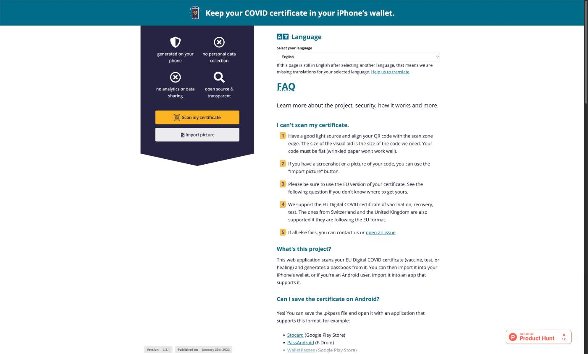
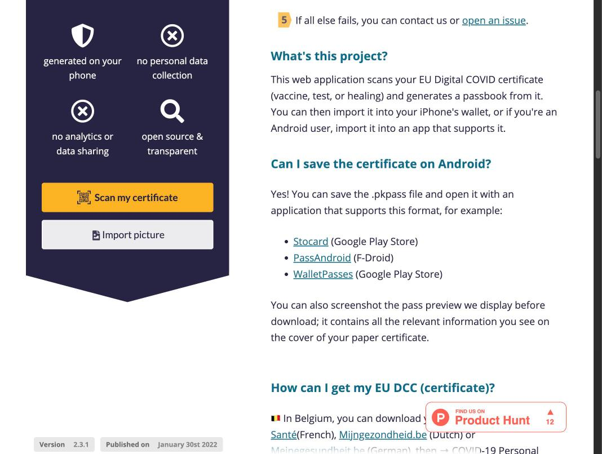
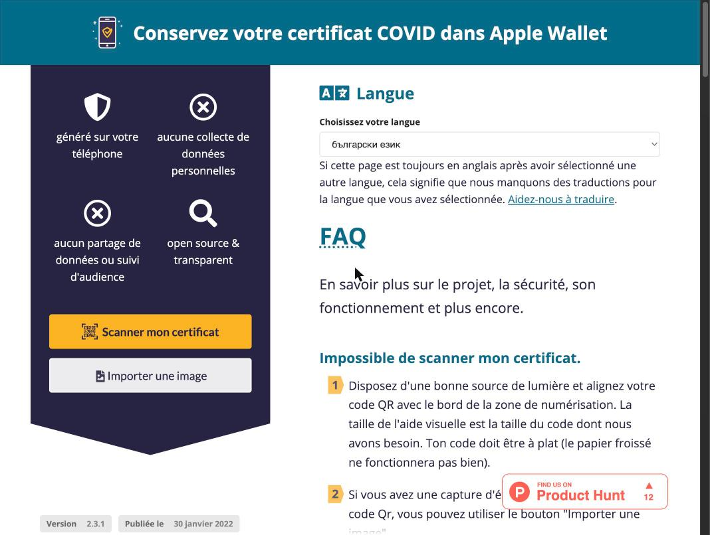

# COVID-19 passbook Generator

> [!IMPORTANT]
> **This project is closed (November 2026).** The EU Digital COVID Certificate regulation ended in 2023 and the Apple certificate used to sign the passes has expired, so the generator can no longer produce valid passes. The signing service has been deleted and [covid19passbook.netlify.app](https://covid19passbook.netlify.app/) now shows a farewell page (source in [`/shutdown`](shutdown/)).
>
> The code stays here for history. Thank you to everyone who used, translated, contributed to and supported this project. ❤️

## How it looked

The site as it was just before the shutdown (version 2.3.1, last published on January 30th, 2022):

| Home (English) | FAQ | Home (French) |
| --- | --- | --- |
|  |  |  |

## In the press

- [Irish Independent: Explainer: how to put your digital Covid cert on your phone](https://www.independent.ie/world-news/explainer-how-to-put-your-digital-covid-cert-on-your-phone/a/134521076.html) (2021)
- [Silicon Luxembourg: Get Your Covid-19 Certificate On Your Smartphone’s Digital Wallet](https://www.siliconluxembourg.lu/get-your-covid-19-certificate-on-your-smartphone-digital-wallet/) (21/07/2021)
- [data.public.lu: Keeping your COVID certificate on your smartphone, the Open Data way](https://data.public.lu/en/posts/keeping-your-covid-certificate-on-your-smartphone-the-open-data-way/) (30/06/2021)
- [Enrique Dans: Here’s how to put your digital vaccination certificate on your Wallet](https://medium.com/enrique-dans/heres-how-to-put-your-digital-vaccination-certificate-on-your-wallet-4c3cb3408e28) (14/08/2021)
- [Fergal Bowers (RTÉ), on X: “Such a handy way to save your EU Covid Digital Cert”](https://twitter.com/FergalBowers/status/1415245159760023555) (14/07/2021)
- [Philip Nolan, on X: via Karl Brophy, #TonightVMTV](https://x.com/philipnolan1/status/1415057096916316160) (07/2021)
- [nwradu blog (Romania): Cum să obții certificatul digital de vaccinare](https://www.nwradu.ro/2021/07/site-certificat-digital-vaccinare-ue/) (01/07/2021)
- [Hacker News: Save EU Digital Covid Certificate in Your iPhone Wallet](https://news.ycombinator.com/item?id=27681340) (06/2021)
- [Product Hunt: EU Digital COVID Certificate to Passbook](https://www.producthunt.com/products/eu-digital-covid-certificate-to-passbook) (06/2021)

## About the project

The aim of this project is to let a user scan a EU Digital COVID Certificate with their smartphone, and generate a passbook, without any data stored on a remote server.

## Test it
~~We are deploying a stable-ish version online so you can try it out.~~ The online version has been shut down. If you want to run the app locally, the last working build configuration is in the git history (`netlify.toml` before the shutdown commit, and `yarn start`). Note that generating a pass also requires a signing service with a valid Apple Pass Type ID certificate.

## Background story
Since EU Digital COVID certificates launched in Luxembourg, there's no application to store your certificate digitally. You can go online and download a PDF or use the grayscale version you got by mail.

Using an application to store those sensitives information can also be an obstacle to some people, and we understand why. Even government application can be questioned, like "tous anticovid" in France, which collect a lot of extra data, including Google pieces of software and usage trackers, especially when you can't look at the source code of those applications.

That's why I came off with the idea of simply using something that does not require installing another piece of software and already handles my credit cards securely: Apple Wallet.

Ok, so, how to do that correctly? Since I don't like spying or fear of it from users, everything possible had to occur on the device itself, including especially:

- [x] Reading the QRCode & decoding it
- [x] Extracting information from it
- [x] Put the user data into the passbook template
- [x] Call the server for manifest signature
- [x] Create the passbook archive with the signature

Apple has designed their passbook (the format of the little card you put in your wallet) in a way to be very secure. So they need to be signed to be visible in the Apple Wallet app. ~~At the moment, I didn't find a way of doing this on the user's device without compromising the signing key.~~ However, we need to sign the manifest which contains `SHA-1` of your data, not the data itself. That's why we thought about a small web service, which does all of this in-memory:

- [x] [perform signature of the manifest](https://github.com/clawfire/covid19-passbook-signature)

That's where @biou jumped into the project and helped me to design the lambda required for this and stick with me on several other tasks since.

## Contributors & open-source

This work could never have been done without the support of the open source community.

- [EHN DCC Schema](https://github.com/ehn-dcc-development/ehn-dcc-schema) for the JSON schema of the code content AND the list of manufacturers, tests, prophylaxis, vaccines, ...
- [Path Check DCC JS SDK](https://github.com/Path-Check/dcc-sdk.js) for the content extraction from the QR Code, since the one offered by the EHN DCC Dev team requires the pubkeys of each countries (which are undisclosed by choice)
- [Path Check debug tool](https://github.pathcheck.org/debug.html) to help explore the QR code content
- [Nimiq JS QR Scanner](https://github.com/nimiq/qr-scanner/)
- [JSZIP](https://stuk.github.io/jszip/)
- [QRCode](https://github.com/davidshimjs/qrcodejs) lib to generate qrcode for the card preview
- [Raw Git](https://raw.githack.com/) to let you call github hosted file in your code using CloudFlare CDN function
